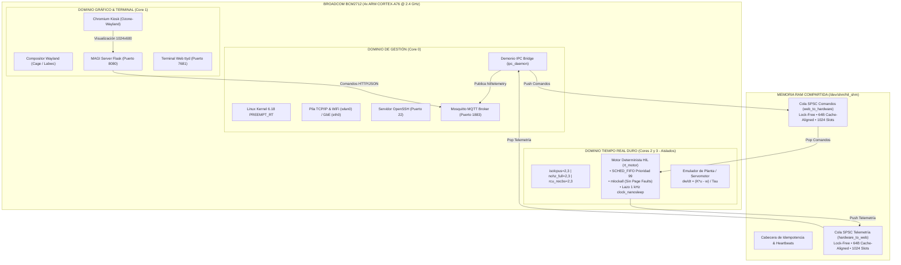
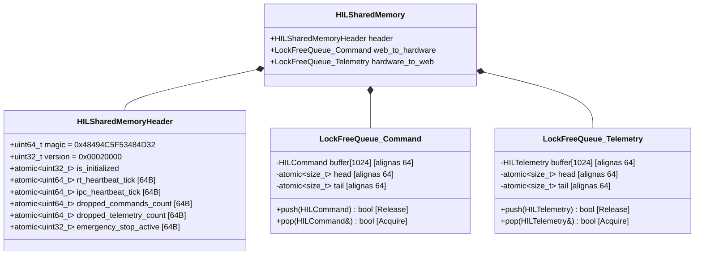
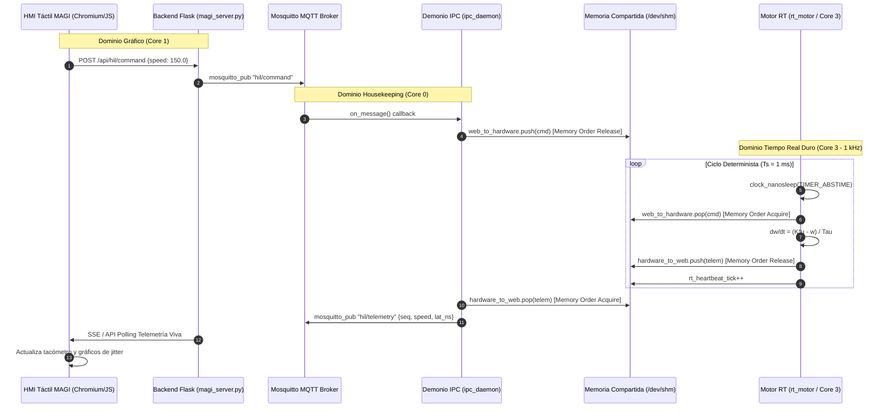
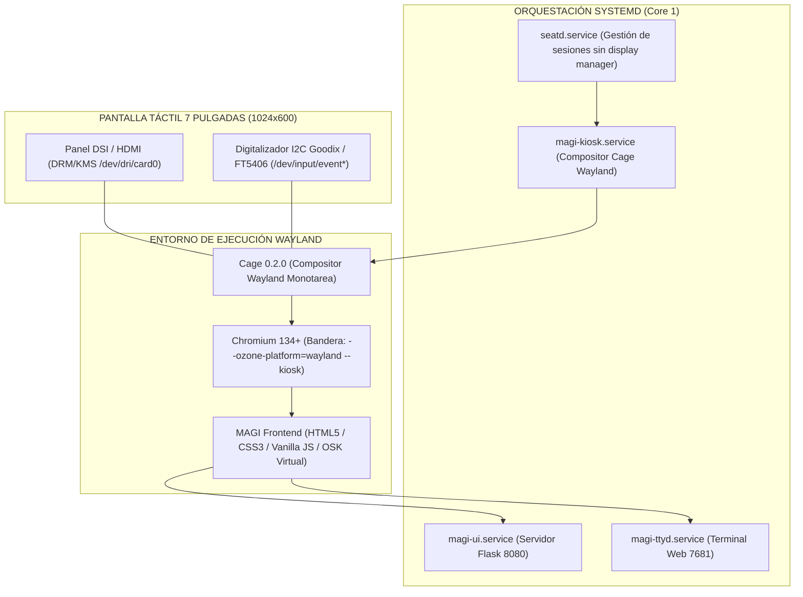

# ARQUITECTURA DEL SISTEMA Y DIAGRAMAS DE FLUJO: HIL-RTOS HYPERVISOR

**Proyecto:** Hipervisor Industrial Hardware-in-the-Loop Determinista  
**Target:** Raspberry Pi 5 (Broadcom BCM2712 - 4x Cortex-A76)  
**Host:** Lenovo ThinkPad L480 (Windows 11 / AntiGravity CLI)  

---

## 1. Diagrama de Separación de Dominios de Silicio

El siguiente diagrama ilustra la partición física de núcleos de CPU en el SoC BCM2712, las afinidades de procesamiento y el aislamiento de las interrupciones del kernel:

---

## 2. Diagrama de Estructura de Memoria Compartida y Caché ARM64

Para erradicar la invalidación de líneas de caché (*False Sharing*) entre el Core 0 (productor/consumidor de red) y el Core 3 (consumidor/productor RT), cada estructura atómica y buffer está estrictamente alineado a 64 bytes (`alignas(64)`):

---

## 3. Flujo de Mensajería Bidireccional Asíncrona (MQTT <-> SHM <-> RT Core)

---

## 4. Pila de Software del Modo Kiosko Wayland en Core 1

