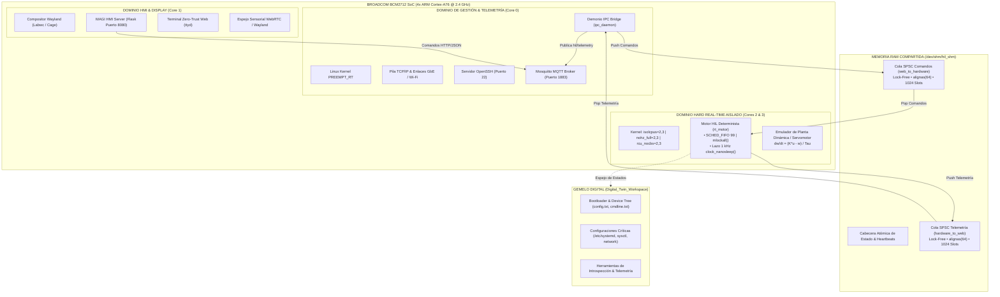

<div align="center">

# HIL-RTOS Digital Twin & Real-Time Hypervisor

[](LICENSE)
[-red.svg)](docs/ARCHITECTURE.md)
[](docs/DETERMINISTIC_RTOS.md)
[](docs/DETERMINISTIC_RTOS.md)
[](CITATION.cff)

**Banco de pruebas Hardware-in-the-Loop (HIL) determinista de grado industrial, gemelo digital bidireccional y estación HMI táctica de telemetría.**

[Visión General](#-elevator-pitch) • [Arquitectura de Silicio](#-arquitectura-y-separación-de-dominios-en-silicio) • [Subsistemas](#-matriz-de-subsistemas-y-código-fuente) • [Quick Start](#-quick-start-reproducible) • [Roadmap](#-roadmap--help-wanted) • [Citación](#-citación-y-licencia)

</div>

---

## ⚡ Elevator Pitch

**HIL-RTOS Digital Twin** es una plataforma de ingeniería embebida y co-simulación para control determinista en tiempo real duro sobre silicio multinúcleo **Raspberry Pi 5 (Broadcom BCM2712 - 4x ARM Cortex-A76)** ejecutando un kernel **Debian GNU/Linux PREEMPT_RT**.

El sistema integra:
1. **Motor HIL Hard-RT (<50 µs Jitter):** Lazo de control a 1 kHz (`SCHED_FIFO` prioridad 99, `mlockall` sin page faults) ejecutado en núcleos aislados de silicio.
2. **IPC Lock-Free C++20:** Canales de memoria compartida SPSC (*Single-Producer Single-Consumer*) alineados a 64 bytes (`alignas(64)`) para anular colisiones de caché (*False Sharing*) entre el kernel RT y el espacio de usuario.
3. **Gemelo Digital Bidireccional:** Espejo estructurado de configuración del target (`Digital_Twin_Workspace/`), árbol de dispositivos (Device Tree), servicios systemd e introspección automatizada.
4. **HMI Táctica MAGI:** Centro de mando visual de baja latencia con telemetría en tiempo real, streaming Wayland/WebRTC y consola interactiva zero-trust.

---

## 🏛 Arquitectura y Separación de Dominios en Silicio

Para garantizar determinismo temporal estricto sin interferencia de la pila de red ni de la interfaz gráfica, el hipervisor y el kernel particionan físicamente los 4 núcleos Cortex-A76:



### Flujo Operativo del Gemelo Digital
1. **Aislamiento en Silicio:** Cores 2 y 3 quedan completamente liberados de interrupciones del kernel (`nohz_full`, `rcu_nocbs`), reservando los ciclos de cómputo exclusivamente para el lazo `rt_motor`.
2. **Intercambio Lock-Free:** `ipc_daemon` (Core 0) y `rt_motor` (Cores 2-3) se comunican a través de memoria compartida POSIX (`/dev/shm/hil_shm`) usando semántica atómica Acquire-Release sin mutexes ni bloqueos del planificador.
3. **Persistencia y Sincronización:** Cualquier cambio en la topología de hardware o parámetros de kernel se sincroniza bidireccionalmente hacia `Digital_Twin_Workspace/` para permitir simulación local idéntica al target físico.

---

## 🎛 Matriz de Subsistemas y Código Fuente

Todos los subsistemas están organizados de forma modular con trazabilidad directa en el árbol de código:

| Subsistema | Módulos y Código Fuente | Enlace de Demostración Operacional | Descripción Técnica |
| :--- | :--- | :--- | :--- |
| **MAGI HMI Táctico** | [`src/hmi_ui/`](src/hmi_ui/)<br/>[`src/hmi_ui/magi_server.py`](src/hmi_ui/magi_server.py) | [https://magi-tunnel.example.org/](https://magi-tunnel.example.org/) | Interfaz táctica Evangelion optimizada para resolución 1024x600 con telemetría en vivo y controles táctiles. |
| **Espejo Sensorial WebRTC / Wayland** | [`src/hmi_ui/templates/mirror.html`](src/hmi_ui/templates/mirror.html)<br/>[`scripts/automation/deploy_mirror.py`](scripts/automation/deploy_mirror.py) | [https://magi-tunnel.example.org/mirror](https://magi-tunnel.example.org/mirror) | Streaming Wayland de latencia ultrabaja, captura de eventos de puntero/teclado y retorno de audio PCM vía ALSA loopback. |
| **Terminal Zero-Trust** | [`config/systemd/magi-ttyd.service`](config/systemd/magi-ttyd.service)<br/>[`scripts/automation/deploy_magi_remote.py`](scripts/automation/deploy_magi_remote.py) | [https://magi-tunnel.example.org/terminal/](https://magi-tunnel.example.org/terminal/) | Consola interactiva `ttyd` enjaulada en el navegador, protegida por autenticación y túnel TLS 1.3 de extremo a extremo. |
| **IPC Lock-Free C++** | [`src/rt_core/LockFreeQueue.hpp`](src/rt_core/LockFreeQueue.hpp)<br/>[`src/rt_core/SharedState.hpp`](src/rt_core/SharedState.hpp)<br/>[`src/ipc_bridge/ipc_daemon.cpp`](src/ipc_bridge/ipc_daemon.cpp) | *(Subsistema Interno en Silicio)* | Buffer anular SPSC de 1024 slots con alineación a 64 bytes (`alignas(64)`) y operaciones atómicas libres de locks. |
| **Motor Hard-RT HIL** | [`src/rt_core/rt_motor.cpp`](src/rt_core/rt_motor.cpp)<br/>[`config/security/99-realtime.conf`](config/security/99-realtime.conf) | *(Subsistema Interno en Silicio)* | Hilo determinista en espacio de usuario a 1000 Hz, afinidad fijada a CPU 2 y 3, prevención de paginación con `mlockall`. |
| **Gemelo Digital & Configs** | [`Digital_Twin_Workspace/`](Digital_Twin_Workspace/)<br/>[`config/`](config/)<br/>[`docs/ARCHITECTURE.md`](docs/ARCHITECTURE.md) | *(Espejo Local Reproducible)* | Réplica fidedigna de `cmdline.txt`, `config.txt`, reglas de udev, sysctl y servicios systemd del dispositivo embebido. |

> [!NOTE]
> Las URLs operacionales listadas arriba corresponden a endpoints de demostración (*placeholders* normalizados). En producción, las instancias se acceden vía túneles cifrados privados definidos en las variables de entorno locales.

---

## 🚀 Quick Start Reproducible

### 1. Requisitos Previos
- Host: Linux o Windows (WSL2 / PowerShell) con Python 3.10+, compilador C++20 (`g++` o `clang++`) y `make` / `cmake`.
- Target HIL: Raspberry Pi 5 con Debian 13 (Trixie) o Raspberry Pi OS con kernel `PREEMPT_RT`.

### 2. Configuración de Entorno
Clona el repositorio y genera tu configuración de credenciales a partir de la plantilla:

```bash
git clone https://github.com/JardinZen/hil-rtos-digital-twin.git
cd hil-rtos-digital-twin
cp .env.example .env
```

Edita `.env` con los parámetros de red y credenciales de acceso seguro de tu banco de pruebas HIL.

### 3. Compilación de los Núcleos RT e IPC
```bash
# Compilar el motor determinista de tiempo real
g++ -O3 -std=c++20 -pthread -Wall src/rt_core/rt_motor.cpp -o build/rt_motor

# Compilar el puente IPC de memoria compartida
g++ -O3 -std=c++20 -pthread -Wall src/ipc_bridge/ipc_daemon.cpp -o build/ipc_daemon
```

### 4. Sincronización e Introspección del Gemelo Digital
Ejecuta la suite de automatización para auditar el estado del hardware y sincronizar el gemelo:

```bash
# 1. Introspección profunda del target físico
python scripts/automation/introspect.py

# 2. Sincronización bidireccional de artefactos y configuración
python scripts/automation/sync_digital_twin.py

# 3. Generación del reporte de estado del arte y telemetría
python scripts/automation/generate_state_of_art.py
```

### 5. Lanzamiento de la Interfaz Táctica HMI
```bash
# Lanzar servidor local MAGI HMI (puerto 8080)
python src/hmi_ui/magi_server.py
```
Abre tu navegador en `http://localhost:8080` para visualizar el panel de control.

---

## 🗺 Roadmap & Help Wanted

Buscamos activamente la colaboración de ingenieros embebidos, especialistas en sistemas de tiempo real y desarrolladores de kernels:

- [ ] **Benchmarks de Latencia `cyclictest` en Kernel 6.6+ PREEMPT_RT:**
  - Ejecución de pruebas estandarizadas bajo carga pesada (`stress-ng --cpu 4 --io 2 --vm 2`).
  - Generación de histogramas de jitter y validación de worst-case execution time (WCET < 50 µs).
- [ ] **Device Tree Overlays para Buses Industriales (SPI / CAN / I2C):**
  - Implementación de overlays para transceptores MCP2515 / MCP2518FD (CAN-FD) sobre SPI con interrupciones dedicadas.
  - Asignación de IRQs a núcleos específicos mediante `smp_affinity`.
- [ ] **Pruebas Unitarias de Estrés para IPC Lock-Free:**
  - Batería de pruebas de concurrencia y contención para `LockFreeQueue.hpp` bajo saturación de 100k msg/s.
  - Validación formal de barreras de memoria Acquire-Release en arquitectura ARM64 (AArch64).
- [ ] **Soporte Multi-Target (STM32 / Zephyr RTOS):**
  - Conexión del gemelo digital con microcontroladores auxiliares mediante protocolo serial de alta velocidad.

Si deseas contribuir, consulta nuestras directrices en [CONTRIBUTING.md](CONTRIBUTING.md) y nuestro [Código de Conducta](CODE_OF_CONDUCT.md).

---

## 📜 Citación y Licencia

### Citación Académica e Industrial
Si utilizas este banco de pruebas, el hipervisor o el gemelo digital en investigaciones, prototipos o publicaciones técnicas, por favor cita el proyecto utilizando los metadatos de [CITATION.cff](CITATION.cff):

```bibtex
@software{hil_rtos_digital_twin_2026,
  author = {JardinZen Digital Team},
  title = {HIL-RTOS Digital Twin & Real-Time Hypervisor},
  year = {2026},
  url = {https://github.com/JardinZen/hil-rtos-digital-twin},
  license = {GPL-3.0}
}
```

### Licencia
Este proyecto está licenciado bajo los términos de la **GNU General Public License v3.0 (GPLv3)**. Consulta el archivo [LICENSE](LICENSE) para conocer todos los derechos y obligaciones.
